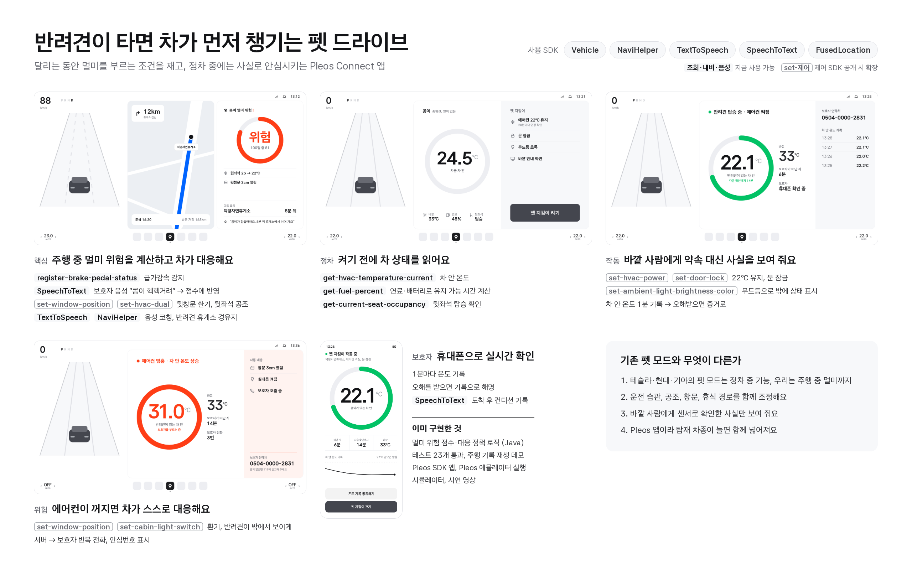

# 펫 드라이브 (가칭)

**반려견이 멀미하기 전에 차가 먼저 운전과 쉬는 간격을 챙기는 Pleos Connect 앱.** 기존 펫 모드(테슬라, 현대·기아 등)는 세워 둔 차를 지키고, 펫 드라이브는 달리는 차를 챙겨요.

2026 현대자동차그룹 차량용 앱 개발 공모전 출품작



## 핵심 기능

| 기능 | 하는 일 | 쓰는 Pleos SDK |
|---|---|---|
| 멀미 케어 주행 | 급가감속, 휴식 후 경과 시간, 차 안 온도, 운전 중 보호자의 말("콩이 헥헥거려")로 멀미 위험 점수(0~100)를 계산하고, 단계에 따라 음성 코칭과 휴게소 안내를 해요 | Vehicle(브레이크, 실내 온도), FusedLocation, SpeechToText, TextToSpeech, NaviHelper |
| 반려견 휴식 경로 | 반려견 놀이터가 있는 휴게소를 경유지로 자동 추가해요 (경유지 최대 2개) | NaviHelper |
| 펫 지킴이 | 휴게소 정차 중 차 안 온도를 1분마다 기록하고, 차 화면에 바깥 사람을 위한 사실 안내를 띄우고, 보호자 휴대폰으로 알려요 | Vehicle(실내 온도, 연료, 좌석, 문), FusedLocation |
| 도착 후 기록 | 말로 반려견 컨디션을 남기면 다음 주행의 기준이 조정돼요 | SpeechToText |

### SDK 제공 범위에 따른 단계

| 단계 | 조건 | 기능 |
|---|---|---|
| 기본 | 지금 공모전 SDK (조회, NaviHelper, TTS, STT, FusedLocation) | 위 표의 모든 판단, 음성 안내, 경유지, 모니터링, 알림 |
| 확장 | 차량 제어 SDK(`CONTROL_CAR_*`) 공개 시 | 뒷창문 환기, 뒷좌석 공조 조절, 무드등·실내등, 펫 지킴이의 에어컨 유지·문 잠금 |

차량 제어 SDK는 공모전 설명회(2026-10-28) 기준 공개 범위가 확정되지 않았어요. 핵심 기능인 멀미 케어는 기본 단계만으로 동작하도록 설계했어요.

## 지금 확인할 수 있는 것

한 번에 확인하려면 `sh tools/check_all.sh`를 실행해요.

### 1. 멀미 위험 점수 로직 (Java, 테스트 포함)

```bash
javac -encoding UTF-8 -d build/test app/src/main/java/ai/petdrive/core/*.java app/src/test/java/ai/petdrive/core/*.java
java -cp build/test ai.petdrive.core.MotionRiskScorerTest
```

테스트 23개: 화면 시안의 세 단계 점수(22, 58, 81), 경계값, 브레이크를 밟은 급감속만 세는 감지, 10분 창, 제어 SDK가 없을 때 창문·공조 동작을 내보내지 않는 정책, 단계 히스테리시스, 보호자 음성 신호, 도착 후 쉬는 간격 조정 등을 확인해요.

- `MotionRiskScorer` — 점수 = 급가감속(최대 50) + 휴식 경과(최대 30) + 실내 온도(최대 20) + 보호자 음성 신호(최근 15분, 1회 15점, 최대 30), 100으로 자름
- `CarePolicy` — 단계별로 차가 할 일 결정 (음성 코칭은 5분 쿨다운, 휴게소 제안은 휴식 전까지 한 번)
- `LevelSmoother` — 화면 단계가 출렁이지 않게 오를 땐 바로, 내릴 땐 3분 연속 충분히 낮을 때만 내림
- `ProfileTuner` — 도착 후 말로 남긴 컨디션("멀미 조금 했어")으로 다음 쉬는 간격 조정 (50~110분)

주행 기록 재생 데모 (서울 → 덕평자연휴게소 가상 주행을 1초 단위로 재생):

```bash
java -cp build/test ai.petdrive.core.DriveReplay        # 기본 단계 (제어 SDK 없음)
java -cp build/test ai.petdrive.core.DriveReplay true   # 확장 단계 (창문·공조 제어 포함)
```

### 2. 멀미 케어 시뮬레이터 (브라우저)

`prototype/index.html`을 브라우저로 열어요. 차량 신호를 슬라이더로 바꾸면 위 Java 로직과 같은 규칙으로 점수와 차의 동작이 바뀌어요. 운전 중 보호자의 말을 흉내 내는 "콩이 헥헥거려" 버튼도 있어요.

두 구현이 같은 값을 내는지는 `node tools/check_simulator.js`로 확인해요.

### 3. 화면 흐름 (클릭형)

`prototype/flow.html`을 열면 출발부터 도착까지 10개 화면을 클릭, 방향키, 버튼으로 넘겨 볼 수 있어요.

### 4. 보호자 화면 데모 (실시간)

`prototype/guardian.html`은 보호자 휴대폰 웹을 흉내 낸 데모예요. 1초가 1분처럼 흐르며 차 안 온도가 갱신되고, "에어컨 멈춤 상황 만들기"를 누르면 27℃를 넘는 순간 위험 알림으로 바뀌어요.

### 5. 시연 영상

`design/video/pet-drive-demo.mp4` (65초, 1920x1080). 세로형 숏폼은 `design/video/pet-drive-shortform.mp4` (65초, 1080x1920). 두 영상 모두 `python3 design/video/make_video.py [--vertical]`로 다시 만들 수 있어요(webm으로 나오고, MP4는 ffmpeg로 변환). 화면 시안으로 만든 프로토타입 영상이에요.

### 6. 데모 앱 (APK)

```bash
sh tools/build_apk.sh        # build/apk/petdrive-demo.apk (Gradle 없이 SDK 도구로 빌드)
adb install -r build/apk/petdrive-demo.apk
```

주행 / 펫 지킴이 / 도착 3화면이에요. 점수 계산은 위 `core` 클래스를 그대로 써요. Pleos 차량·에뮬레이터에서는 Pleos Vehicle SDK(브레이크, 실내 온도, 에어컨, 기어)와 CarPropertyManager(속도)로 차량 신호를 받고, NaviHelper로 목적지 경로와 반려견 휴게소 경유지를 넣고, 음성은 Pleos TTS·STT를 써요. 일반 기기에서는 가상 주행 기록(60배속)으로 동작해요. "급정거", "콩이 힘들어해" 버튼으로 값을 직접 넣어 볼 수 있어요. 안드로이드 에뮬레이터(API 34, 1920x1080)에서 실행한 녹화는 `design/video/app-run.mp4`예요.

## 테스트 환경

- 로직 테스트: JDK 11 이상 (`javac`, `java`). OpenJDK 27에서 확인
- 화면 시안: Pleos Connect-S 1920x1080 기준, Pleos 디자인 가이드의 색상 토큰과 Asta Sans 폰트 사용
- Pleos Connect 에뮬레이터 버전: v2.1.0 (API 34, x86_64). Virtual Console(`adb forward tcp:8088 tcp:8088`)로 차량 값을 바꿔 확인. 실행 녹화 `design/video/app-run-pleos.mp4`
- 빌드: JDK 17~21, Gradle 8.11, AGP 8.7.3, compileSdk 35, minSdk 28. Pleos SDK 저장소는 `settings.gradle.kts`에 있음
- APK: `sh tools/build_apk.sh` → `build/apk/petdrive-demo.apk` (release 빌드, 데모용 디버그 키 서명). 차량 신호 연결은 `app/src/main/java/ai/petdrive/app/CarSignals.java`

## 폴더 구조

```
app/src/main/AndroidManifest.xml        Pleos 권한 선언 (조회, 제어, 내비, 음성, 위치)
app/src/main/java/ai/petdrive/app/       데모 앱 화면 (주행, 펫 지킴이, 도착)
app/src/main/java/ai/petdrive/core/      멀미 위험 점수, 대응 정책
app/src/test/java/ai/petdrive/core/      테스트
prototype/index.html                    멀미 케어 시뮬레이터
prototype/flow.html                     클릭형 화면 흐름
prototype/guardian.html                 보호자 화면 실시간 데모
design/png/                             화면 시안, 설명 보드
design/screens/                         화면 시안 HTML 원본 (build.py로 생성, render.sh로 PNG 렌더)
design/video/                           시연 영상과 생성 스크립트
docs/                                   기획서, 접수양식 작성본, 제출 체크리스트, 2차 PT 대본·예상 질문
tools/fill_form.py                      기획서 마크다운으로 공식 접수양식 02 칸과 보드 이미지를 채움
tools/make_submit.sh                    메일 첨부 파일을 submit/에 모음
tools/make_pdf.py                       접수양식 02를 읽기용 PDF로 (mammoth 필요)
tools/check_simulator.js                시뮬레이터와 Java 로직의 점수 일치 확인
tools/check_all.sh                      로직 테스트, 재생 데모, 시뮬레이터 일치, 접수양식 생성을 한 번에
```

## 주행 중 화면 원칙

Pleos 디자인 가이드의 주행 원칙(1~2초 확인, 한 손 조작, 자동 애니메이션 금지)과 Android for Cars 기준(주행 중 텍스트 1~3줄)을 따라요. 주행 중에는 링 하나와 한 줄 상태만 보여 주고, 안내는 음성으로 해요.

## 출처와 라이선스

- 폰트: Asta Sans (42dot, SIL Open Font License) — `design/screens/fonts/OFL.txt`
- 디자인 토큰: Pleos Connect 디자인 가이드 (document.pleos.ai)
- 통계: KB경영연구소 한국 반려동물 보고서(2021, 2025), 한국관광공사 반려동물 동반 여행 실태조사(2022), 한국교통안전공단(2024), 한국도로공사 휴게소 반려동물 편의시설 현황(2025)
- 생성형 AI 도구로 자료 조사, 문서 초안, 화면 시안 작성을 도왔어요. 로직과 구조는 팀이 직접 설명할 수 있도록 테스트와 함께 정리했어요.
